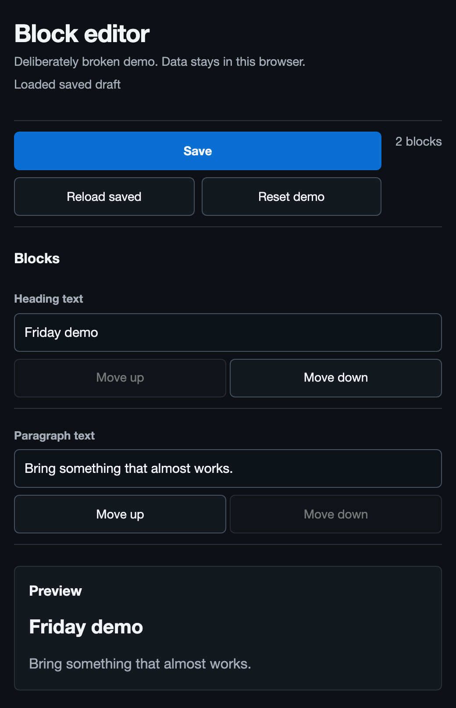

# One bug, three clouds: building Repo Rodeo

> Fictional retrospective, written before the cloud runs. The seeded bug and local screenshot are real; the product, provider outcomes, and repair stories are imagined. See the [working notes](README.md) and [claim ledger](claims.json) for assumptions we'll replace with evidence.

The button was still there when the editor said “Saved.” It disappeared when we reloaded the page.

That was the entire bug report. Move the “Join the waitlist” block to the top, save, reload, and watch it vanish. No intermittent network failure, no production database to copy, no argument about what the reporter meant by “broken.” Three blocks went in. Two came back.

We built Repo Rodeo around that little disappearing button. Give it a GitHub issue and a reproduction recipe, and it prepares the application in a sandbox, proves the bug exists, and opens independent repair attempts from the prepared environment. Each attempt gets a coding agent. You get the original app, the proposed repairs, and enough evidence to disagree with the agents.

We ran the same job on E2B, Daytona, and MainBrella. E2B made branching a running environment convenient. Daytona gave us useful ways to prepare and reuse environments. MainBrella got the demonstration working with filesystem saves and fresh processes, which also made the gaps in our own platform painfully specific.

The part I kept showing people was the pair of application links. Open the original and lose the button. Open a candidate, repeat the same clicks, and keep it. Nobody had to install Node to decide whether the repair was worth reading.

## A small bug we could keep breaking

We planted this bug on purpose in the standalone fixture at `/repo-rodeo-bug`. It's a small block editor with a heading, a paragraph, and a button. You can edit their text, move them up or down, and save them in browser storage. It needs no account or backend. Reset puts the demo back where it started.

That makes it a useful infrastructure fixture. It doesn't make it evidence that an agent can fix a stranger's application. An unfamiliar repository with a bad setup guide is a separate, much less cooperative test.

The editor keeps its current draft in memory. Saving serializes it into `localStorage`; reloading reads that saved copy. The serializer assigns zero-based positions and then makes this mistake:

```ts
blocks
  .map((block, position) => ({ ...block, position }))
  .filter(block => block.position);
```

Position zero is false. The first block gets thrown away. Save reports success because the storage write succeeded, and the editor keeps displaying its untouched draft. Reload is where the lie becomes visible. Moving the button just makes the missing block easy to recognize; saving the original order loses the heading instead.

The [saved editor still shows all three blocks](assets/before-reload.png). Reload that same draft and the heading and paragraph survive, but the button doesn't.



Our [reproduction](../fixtures/editor/repro.spec.js) opened a fresh browser context, reset the demo, moved the button, saved, and reloaded. It compared the ordered block IDs and their text with the values before saving. That last part mattered: checking whether the page still contained “Join the waitlist” could pass because some help text mentioned it.

Once that test failed, we had something an agent's explanation couldn't talk us out of. A patch had to preserve the document across a reload. Keeping the button visible until the tab closed wasn't a repair.

## Prepare once, then let the attempts diverge

Installing the project was shared work. Editing it wasn't.

We pinned the application revision and lockfile, installed dependencies, started the development server, and ran the reproduction before admitting any repair attempts. A failed install produced an install report. A reproduction that unexpectedly passed stopped the job. Neither outcome earned a “bug reproduced” badge.

The prepared environment became the starting point for three attempts. We held the agent build, model configuration, prompt, and budget constant across providers. The agents could take different paths, but they didn't get different definitions of success. An external verifier kept the reproduction and regression checks outside the files the repair agents could edit.

The candidate diff still needed review. A browser test can demonstrate the behavior it exercises; it can't establish that every other behavior is sound. We also kept the original environment intact so a reviewer could repeat the failure while a candidate was being tested.

Getting those two links onto one page was easy. Giving “copy this environment” an honest meaning across three providers took more care.

## E2B: keep the running starting point

> Experiment note: set an explicit fork lifetime. The [documented default](https://docs.e2b.dev/sandbox/fork#fork-timeout) is 15 seconds, too short for the repair experiment.

E2B's [fork operation](https://docs.e2b.dev/sandbox/fork) captures a running sandbox's filesystem and memory, then creates independent sandboxes from that capture. Our dev server was already running at the checkpoint. The attempts inherited that prepared process state as well as the checkout and installed packages.

We took the checkpoint before starting the agents. Otherwise, copying the machine could also copy work already in progress, which is a pretty entertaining way to ruin an experiment. Each agent started only after its own sandbox was ready.

The useful outcome was that environment preparation stopped being part of every repair attempt. We could leave one candidate alone, throw another away, and try again from the same starting state. We also paused a prepared environment and returned to it later, with its process state preserved through the explicit memory-preserving pause. [E2B documents that persistence behavior](https://docs.e2b.dev/sandbox/persistence), along with the need to reconnect clients.

That reconnection was our responsibility. Forking briefly pauses the source and drops active connections. A terminal stream disappearing couldn't mean “the agent failed,” and an old preview connection couldn't establish that a resumed server was reachable. We reconnected and checked the application again.

There was another easy assumption to get wrong: our verifier's browser was outside the app sandbox. Forking the server did nothing to that browser's `localStorage`. Every preview origin got a fresh browser context and the same reset-and-click sequence. The button had to disappear because of the application code, not because a previous attempt had left a broken document behind.

The diagram shows the two copying strategies we used. The process lines continue through a memory fork; a filesystem restore needs a new process start. Neither branch includes the external browser.


## Daytona: move setup out of the next attempt

Daytona worked well when we treated environment preparation as something worth keeping. We prepared the repository and dependencies, saved the environment, and created the repair sandboxes from that common starting point. We didn't have to ask an agent to rediscover how to install the app every time it wanted another try.

For this pass we used container sandboxes. Their snapshots preserve filesystem state and require the source to be stopped for capture, so our adapter restarted the application and waited for readiness in each new sandbox. Daytona also documents VM snapshots that include memory; the behavior depends on the sandbox class and capture options. Calling all of those operations “snapshot” doesn't make them interchangeable. [Daytona's snapshot documentation](https://www.daytona.io/docs/en/snapshots/#create-snapshot-from-sandbox) spells out the distinction.

Volumes were useful for keeping downloaded material and artifacts beyond one sandbox's lifetime. Daytona exposes them as [shared filesystem mounts backed by object storage](https://www.daytona.io/docs/en/volumes/). We kept the working checkouts private to each attempt. Sharing a writable source directory would let one agent change another agent's experiment, even if the machines had different IDs.

We tried warm pools as a separate setup. With the feature enabled for the organization, a compatible request could claim a prepared sandbox instead of waiting for a new one. But the documented matching rules exclude requests with custom volumes, environment variables, or secrets. Our volume recipe and our pool recipe therefore had separate results. Combining their best properties into one row would have described a configuration we hadn't run. [Warm-pool requirements](https://www.daytona.io/docs/en/warm-pools/) belong beside any timing result that depends on them.

Daytona's [computer-use tools](https://www.daytona.io/docs/en/computer-use/) also let us open the app inside the sandbox and record the disappearing button. That helped when inspecting a candidate interactively. We still used the same external browser test for acceptance on every provider, so a change of screenshot tool couldn't change what counted as a fix.

What I liked about this pass was how much routine preparation we could reuse. What needed discipline was keeping that reuse from turning into shared mutable state between supposedly independent attempts.

## MainBrella: restart the processes and keep the promise small

MainBrella is ours, so this was the pass where a flattering abstraction would have been easiest to write.

> Experiment update: the backend now includes feature-gated, filesystem-only `POST /containers/fork`. When the deployment advertises `persistence.filesystemFork`, try that native operation first. The saved-workspace path imagined below remains a separate fallback experiment. Neither has been verified in a provider run here.

The working path was straightforward. Save the prepared filesystem. Restore it into separate containers. Start the app in each container, wait for the route to respond, and run the same reproduction. The checkout and dependencies survived; the dev-server process had to start again. That matches the documented [saved-workspace behavior](https://mainbrella.com/docs/containers/#saved-workspaces): files and metadata are preserved, running processes and memory are not.

For this bug, that was enough. Its failure lived in the serializer, and the browser could reconstruct all the input it needed. A fresh process lost no evidence the test depended on. We got independent repair attempts and working previews without needing to pretend we'd forked a running computer.

The adapter returned that difference explicitly. “Ready from saved files” meant the app had been restarted and checked. A workload that required an in-memory queue or an unrecoverable debugger session would have been outside this path's capabilities. The editor gave us no basis for claiming otherwise.

We stored the diffs, test output, screenshots, and run record outside the containers before deleting them. Object storage suited those artifacts. It didn't become a mounted directory merely because the API could upload a file to it. Keeping that distinction visible stopped us from claiming we'd reproduced Daytona's volume workflow.

This gave us a much better roadmap than a list of competitor features. We needed reliable job reattachment so closing the review page couldn't lose track of an agent. We needed preview renewal to be understandable when someone returned later. We wanted process-preserving checkpoints for bugs whose interesting state couldn't be rebuilt. Each request now came with a user action we could demonstrate.

## The repair still had to survive a reload

The following candidate outcomes are provisional fictional examples, not results of the local deterministic controls or any provider experiment. Replace the table when actual repair attempts finish. The tempting bad patch kept the current array on screen after Save. The original app already did that. Its preview looked convincing right up to the reload.

| Candidate | What changed | What the reviewer could reproduce |
| --- | --- | --- |
| A | Removed the truthiness filter | All blocks and their order survived reload |
| B | Reworked serialization to retain every block | The same behavior passed, with a larger diff to review |
| C | Kept the current draft visible after saving | The first block still disappeared on reload |

We preferred the small patch. Positions came directly from the array index; there was no invalid position for that filter to remove. The larger rewrite worked in the exercised cases, but this bug didn't need a new persistence design.

That judgment remained separate from the provider comparison. A successful agent run on one machine doesn't establish that its cloud caused the success. We compared infrastructure using the same preparation and verification work, and kept repair outcomes attached to their individual attempts.

We timed through to a usable application, including process startup and the readiness check. We recorded cold preparation separately from reuse, and accounted for the original environment, repair sandboxes, and idle pool capacity when comparing compute cost. A fast create response was of little comfort while the preview was still refusing connections.

## Close the tab, then delete the machines

The more useful lifecycle checks happened after the happy path. We closed the review page while an agent was working, returned to a preserved environment after a break, and deleted finished sandboxes after exporting their evidence.

Closing a browser tab had to leave a job we could find again. Returning later had to tell us whether the provider was resuming processes or starting new ones. Deleting a sandbox had to leave the candidate's diff and test result readable, with the live preview clearly expired. A dead machine's last screenshot couldn't pass for an interactive app.

By the end, each provider could carry this editor through a reproduced failure, independent repair attempts, a passing candidate, and a reviewable result. They got there with different amounts of state preserved and different setup work on the critical path. We kept those differences in the report rather than compressing them into a winner's badge.

For the pull request, a human reviewed the chosen diff and approved publication. The test was attached to the repair, and the original failing run stayed available. That was enough to make the maintainer's next step small: read the change, run the reproduction, and decide.

The next bug needs to come from a repository we don't control. This editor let us finish the plumbing with a failure we could explain down to one boolean conversion. Someone else's missing environment variable, background worker, or half-written setup guide will tell us how much of that plumbing is useful.
